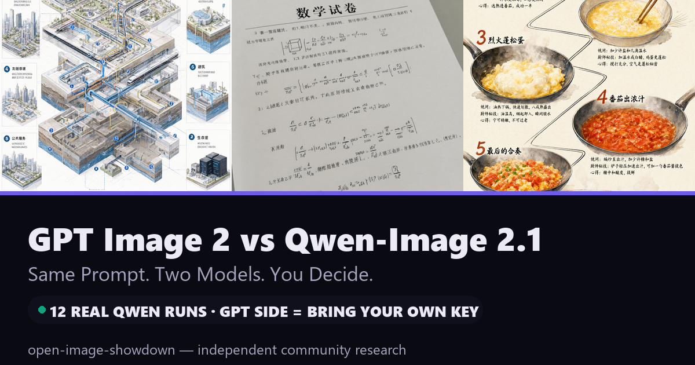
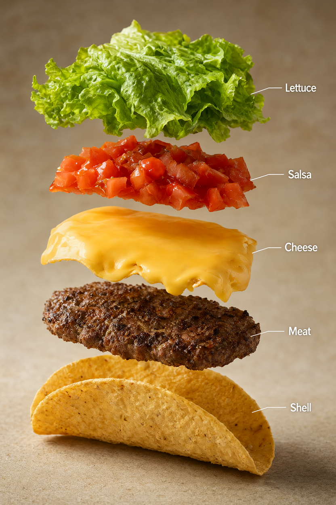
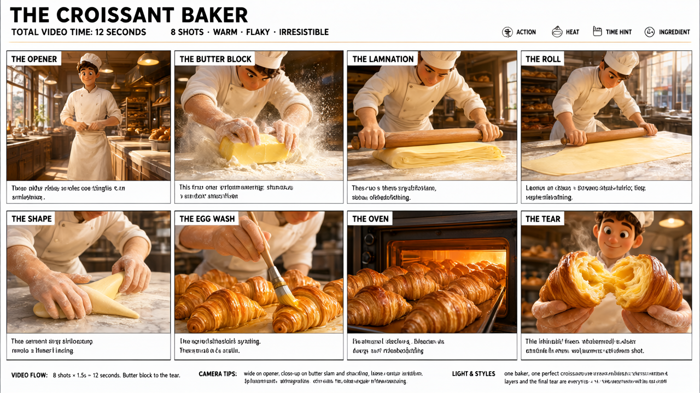

<div align="center">



# Open Image Showdown

## GPT Image 2 vs Qwen-Image 2.1

### Same Prompt. Two Models. You Decide.

**12 real Qwen-Image 2.1 runs on an AMD RX 7900 XTX · GPT side brought by the community, key by key**

[](https://github.com/AIwork4me/open-image-showdown/actions)
[](#the-12-challenges)
[](docs/QWEN_12_CASE_RESULTS.md)
[](#bring-your-key--submit-a-gpt-image-2-result)

[Challenges](#the-12-challenges) · [Website](https://aiwork4me.github.io/open-image-showdown/) · [How to contribute a GPT result](CONTRIBUTING.md) · [Methodology](docs/METHODOLOGY.md) · [中文说明](README.zh-CN.md)

</div>

---

**The idea in one minute.** Every case below is a frozen, sha256-hashed prompt
sourced (with attribution) from the MIT-licensed
[awesome-gpt-image-2](https://github.com/freestylefly/awesome-gpt-image-2)
library. We ran the **Qwen side for real** — locally, on an AMD Radeon RX 7900
XTX under ROCm on native Windows, bf16 weights, 40 steps, fixed seed 42, every
run record committed. The **GPT Image 2 side is deliberately empty**: this
project owns no OpenAI API key and will not pretend otherwise. If you have
one, you run **one command**, preview the exact cost, confirm, and attach the
result to a GitHub issue. Reviewed submissions turn open challenges into
**verified comparisons** — your images, your credit.

**No fake pairs, no invented rankings, no unverifiable claims.** A GPT image
appears only after a human reviews its run evidence. Model identity is never
inferred from visual similarity.

## The 12 challenges

| # | Case | What it stresses | Canvas | Status |
|---|---|---|---|---|
| 1 | [Urban Metabolism Atlas](https://aiwork4me.github.io/open-image-showdown/#/case/case-1) | 12 bilingual panels, brutal typography | 720×1280 | 🟡 Open |
| 13 | [Math Exam Paper Photo](https://aiwork4me.github.io/open-image-showdown/#/case/case-13) | photorealism + dense CJK text | 1024×1024 | 🟡 Open |
| 14 | [Tomato & Egg Recipe Infographic](https://aiwork4me.github.io/open-image-showdown/#/case/case-14) | Chinese calligraphy + layout | 720×1280 | 🟡 Open |
| 344 | [NOIR Streetwear Campaign](https://aiwork4me.github.io/open-image-showdown/#/case/case-344) | brand realism, minimal text | 1024×1024 | 🟡 Open |
| 443 | [Exploded Taco Infographic](https://aiwork4me.github.io/open-image-showdown/#/case/case-443) | 5 exact English labels | 832×1248 | 🟡 Open |
| 510 | [Bichon Shop App Icon](https://aiwork4me.github.io/open-image-showdown/#/case/case-510) | clean app-icon craft | 1024×1024 | 🟡 Open |
| 414 | [Morning Bedroom Photography](https://aiwork4me.github.io/open-image-showdown/#/case/case-414) | candid photorealism | 832×1248 | 🟡 Open |
| 434 | [Tokyo Street Film Portrait](https://aiwork4me.github.io/open-image-showdown/#/case/case-434) | film grain + signature text | 720×1280 | 🟡 Open |
| 419 | [Croissant Baker Storyboard](https://aiwork4me.github.io/open-image-showdown/#/case/case-419) | 8-panel storyboard | 1280×720 | 🟡 Open |
| 390 | [Felt Diorama: Japan](https://aiwork4me.github.io/open-image-showdown/#/case/case-390) | handmade texture world | 832×1248 | 🟡 Open |
| 396 | [Vintage Dragon Encyclopedia](https://aiwork4me.github.io/open-image-showdown/#/case/case-396) | retro infographic density | 768×1088 | 🟡 Open |
| 474 | [Minimal Travel Poster Series](https://aiwork4me.github.io/open-image-showdown/#/case/case-474) | flat design + destination type | 1280×720 | 🟡 Open |

<p>



</p>

*All three images above are real, unedited Qwen-Image 2.1 outputs from this
repo — run records: [gallery/qwen](gallery/qwen) · full results:
[docs/QWEN_12_CASE_RESULTS.md](docs/QWEN_12_CASE_RESULTS.md).*

## Bring your key → submit a GPT Image 2 result

```bash
# 1) your key, in the environment only — never in a file, issue, or PR
export OPENAI_API_KEY=sk-...            # PowerShell: $env:OPENAI_API_KEY="sk-..."

# 2) pick a case — shows model, size, quality, ESTIMATED COST, then waits for YES
uv run --no-project python -I tools/generate_gpt.py --case case-443

# 3) attach the generated image.png + run.json + SUBMISSION.md to an issue:
#    https://github.com/AIwork4me/open-image-showdown/issues/new?template=gpt_submission.md
```

The CLI pins `gpt-image-2-2026-04-21`, defaults to **exactly one image**,
pixel-matches the Qwen canvas (gpt-image-2 accepts custom 16-px-multiple
sizes — both models face the same canvas), bounds retries at 2, and
**self-scans every artifact for key material before writing**. See
[docs/SECURITY.md](docs/SECURITY.md).

Generated images elsewhere (ChatGPT, other clients)? Manual uploads are
welcome — they're labeled by evidence tier, never auto-promoted. Details:
[CONTRIBUTING.md](CONTRIBUTING.md).

## Reproduce the Qwen side

Requires an AMD gfx1100 GPU (RX 7900 XTX), the [qwen-image-rocm](https://github.com/AIwork4me/qwen-image-rocm)
engine (weights + ComfyUI pinned by commit), Windows + ROCm:

```powershell
# boot the Quality server (bf16, --disable-smart-memory, SDPA math)
powershell -File <qwen-image-rocm>\phase2-comfyui\launch_comfyui.ps1 -Port 8188 `
  -SdpMode math -ComfyArgs "--disable-smart-memory"
```

```bash
uv run --python 3.12 --with requests --with websocket-client --with jsonschema \
  python -I tools/generate_qwen.py --base-url http://127.0.0.1:8188
```

Same pinned weights (`Comfy-Org/Qwen-Image-2.1@aacf31a6`) + ComfyUI commit +
seed 42 reproduce every image deterministically. 12/12 ran clean at ~1 MP
(46–58 s each, 14–16 GB VRAM) — including this GPU stack's first-ever
non-square canvases. [Full run records →](docs/QWEN_12_CASE_RESULTS.md)

## Repository map

```
cases/            12 frozen case manifests + canonical prompt.txt (sha256-pinned)
gallery/qwen/     real Qwen outputs + per-run provenance records
submissions/      community GPT submissions (review-gated)
tools/
  generate_gpt.py     BYOK GPT Image 2 CLI (cost gate, key self-scan)
  generate_qwen.py    Qwen batch driver (reuses the engine repo's client)
  build_cases.py      deterministic case freezer
  validate_gallery.py integrity gate (schema, sha256, dims, secrets, paths)
  make_social_cards.py 1200×630 share cards from real images
web/              Vite + React + TS site (static, keyless by construction)
tests/            contract tests (BYOK API contract, security invariants, gallery)
docs/             P0 audit, run results, methodology, security, licenses
```

## Trust & verification

- **Statuses are schema-enforced**: `OPEN_CHALLENGE` → `COMMUNITY_SUBMITTED` → `REVIEWED_COMPARISON` (or `BLOCKED`). [Methodology →](docs/METHODOLOGY.md)
- **Automated gate** on every PR: prompt/image sha256 recomputation, dimension checks, provenance presence, duplicate detection, secret scanning, site-data consistency, static build. [CI →](.github/workflows/ci.yml)
- **Independent**: *Independent community research project. Not affiliated with or endorsed by OpenAI, Alibaba/Qwen, or AMD.*
- **Three license layers, stated separately**: code MIT · case prompts MIT via the upstream library with attribution · Qwen images CC BY-NC 4.0 (Qwen Research License governs the weights). [Licenses & sources →](LICENSES_AND_SOURCES.md)

## Acknowledgments

- [freestylefly/awesome-gpt-image-2](https://github.com/freestylefly/awesome-gpt-image-2) and the original prompt authors credited per case
- [AIwork4me/qwen-image-rocm](https://github.com/AIwork4me/qwen-image-rocm) (engine), [ComfyUI](https://github.com/comfyanonymous/ComfyUI), Qwen-Image-2.1, GPT Image 2

---

<div align="center"><b>Same Prompt. Two Models. You Decide.</b><br/><sub>同一提示词，两个模型，你来评判。</sub></div>
