# GPT Image 2 对决 Qwen-Image 2.1

**同一提示词，两个模型，你来评判。**

**12 张社区参考图 × 13 次真实 Qwen 生成** <!-- gallery-refs:12 -->

<sub>每组左侧：提示词的来源**社区参考图** —— 已获全部原作者授权镜像（记录于 2026-11-02；字节经 sha256 与审计指纹核验），并始终标注**模型身份未验证**。右侧：**真实、未修图的本机 Qwen-Image 2.1 运行结果**。第三个位置 —— *经过验证的 GPT Image 2 结果* —— 在有人带着运行证据投稿并通过审核之前，刻意保持空白。[权利审计 →](docs/REFERENCE_IMAGE_AUDIT.md)</sub>

[English](README.md) · [全部对比](https://aiwork4me.github.io/open-image-showdown/) · [投稿指南](CONTRIBUTING.md) · [方法论](docs/METHODOLOGY.md)

---

### #443 · 塔可爆炸拆解信息图 —— 5 个精确英文标签

<table><tr>
<th width="50%">🟡 社区参考图<br><sub>模型未验证 · 已获作者授权镜像</sub></th>
<th width="50%">🟣 Qwen-Image 2.1 · 本机 ROCm 运行</th>
</tr><tr>
<td align="center">
<a href="https://x.com/Strength04_X/status/2056018963084226866">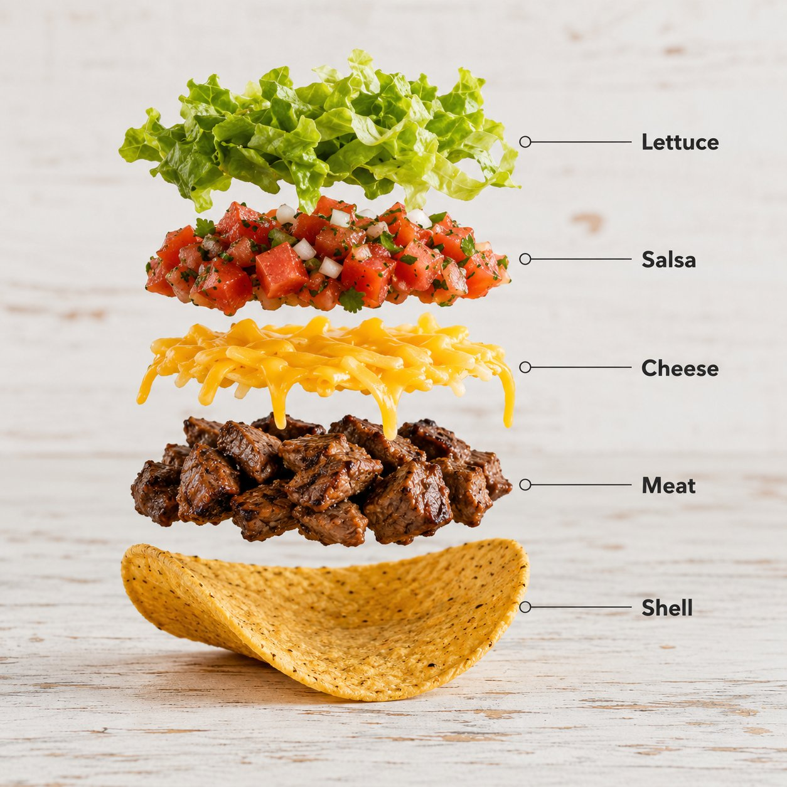</a><br>
<sub>1254×1254 · © @Strength04_X · <a href="https://github.com/freestylefly/awesome-gpt-image-2/blob/63e6176fa01be51c000108dacd72716d3e46784b/docs/gallery-part-2.md#case-443">案例库来源 ↗</a></sub>
</td>
<td align="center"><a href="https://aiwork4me.github.io/open-image-showdown/#/case/case-443">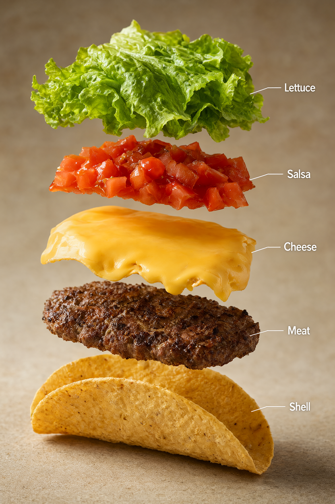</a><br><sub>832×1248 · <a href="gallery/qwen/case-443.run.json">运行记录</a></sub></td>
</tr></table>

<sub>画布不同（参考图为方形，Qwen 为竖版）——各自完整展示，绝不裁切。提示词与上游**逐字节一致**。[提示词](cases/case-443/prompt.txt) · [案例页](https://aiwork4me.github.io/open-image-showdown/#/case/case-443)</sub>

---

### #419 · 可颂烘焙分镜板 —— 8 格连续叙事

<table><tr>
<th width="50%">🟡 社区参考图<br><sub>模型未验证 · 已获作者授权镜像</sub></th>
<th width="50%">🟣 Qwen-Image 2.1 · 本机 ROCm 运行</th>
</tr><tr>
<td align="center">
<a href="https://x.com/TechieBySA/status/2053523784481554759">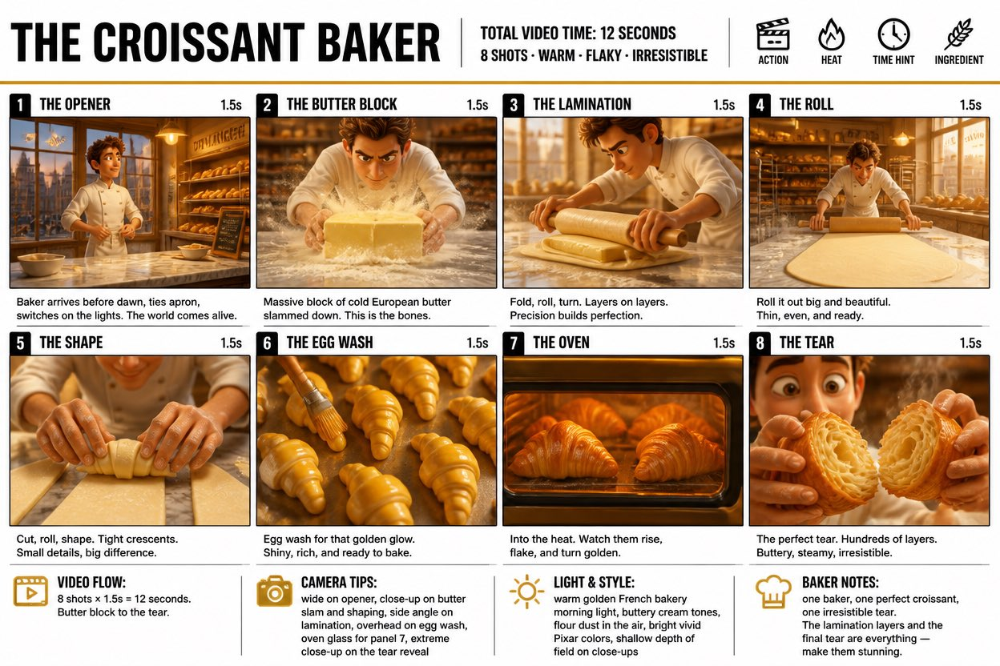</a><br>
<sub>1248×832 · © @TechieBySA · <a href="https://github.com/freestylefly/awesome-gpt-image-2/blob/63e6176fa01be51c000108dacd72716d3e46784b/docs/gallery-part-2.md#case-419">案例库来源 ↗</a></sub>
</td>
<td align="center"><a href="https://aiwork4me.github.io/open-image-showdown/#/case/case-419">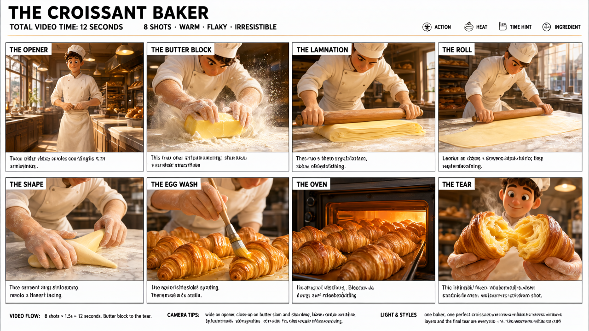</a><br><sub>1280×720 · <a href="gallery/qwen/case-419.run.json">运行记录</a></sub></td>
</tr></table>

<sub>画布比例略有差异（3:2 对 16:9）——如实披露、不做裁切。提示词**逐字节一致**。[提示词](cases/case-419/prompt.txt) · [案例页](https://aiwork4me.github.io/open-image-showdown/#/case/case-419)</sub>

---

### #510 · Bichon Shop 拟物图标 —— 图标工艺

<table><tr>
<th width="50%">🟡 社区参考图<br><sub>模型未验证 · 已获作者授权镜像</sub></th>
<th width="50%">🟣 Qwen-Image 2.1 · 本机 ROCm 运行</th>
</tr><tr>
<td align="center">
<a href="https://x.com/iamaiistudio/status/2071923809788285125">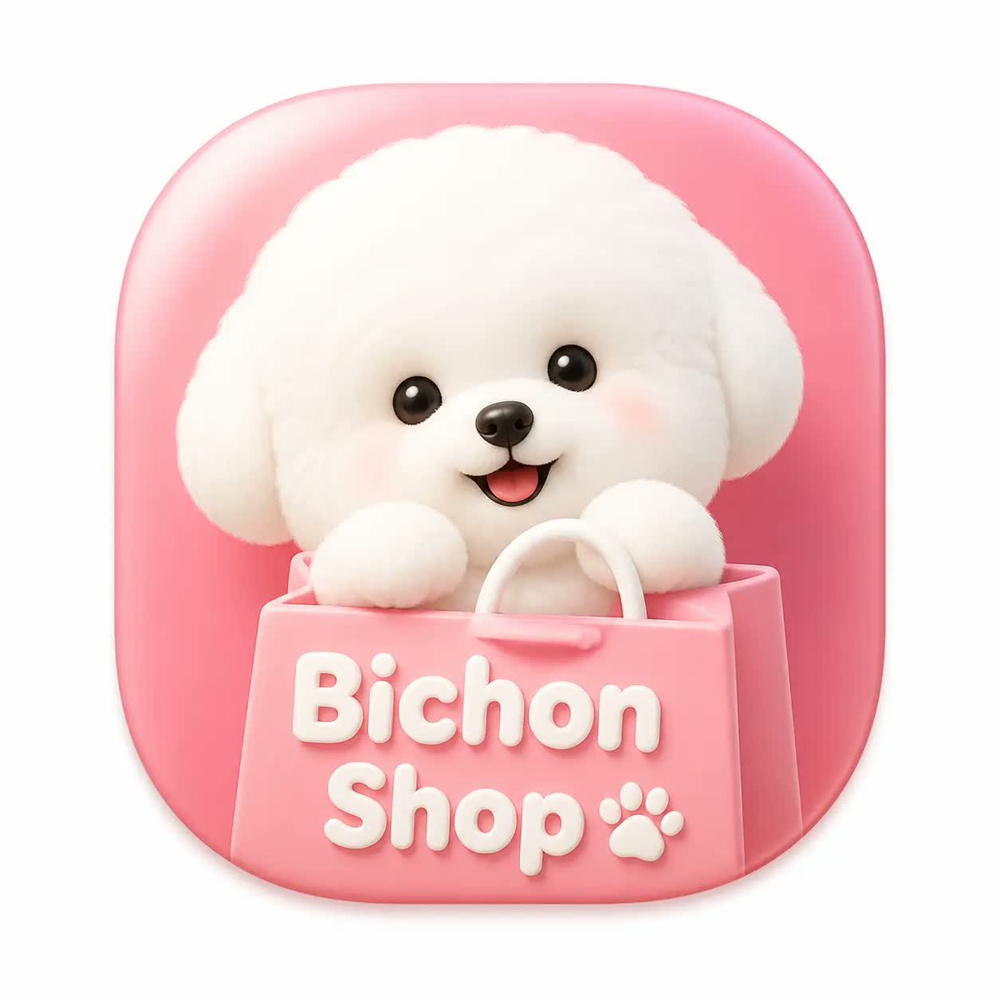</a><br>
<sub>1254×1254 · © @iamaiistudio · <a href="https://github.com/freestylefly/awesome-gpt-image-2/blob/63e6176fa01be51c000108dacd72716d3e46784b/docs/gallery-part-2.md#case-510">案例库来源 ↗</a></sub>
</td>
<td align="center"><a href="https://aiwork4me.github.io/open-image-showdown/#/case/case-510">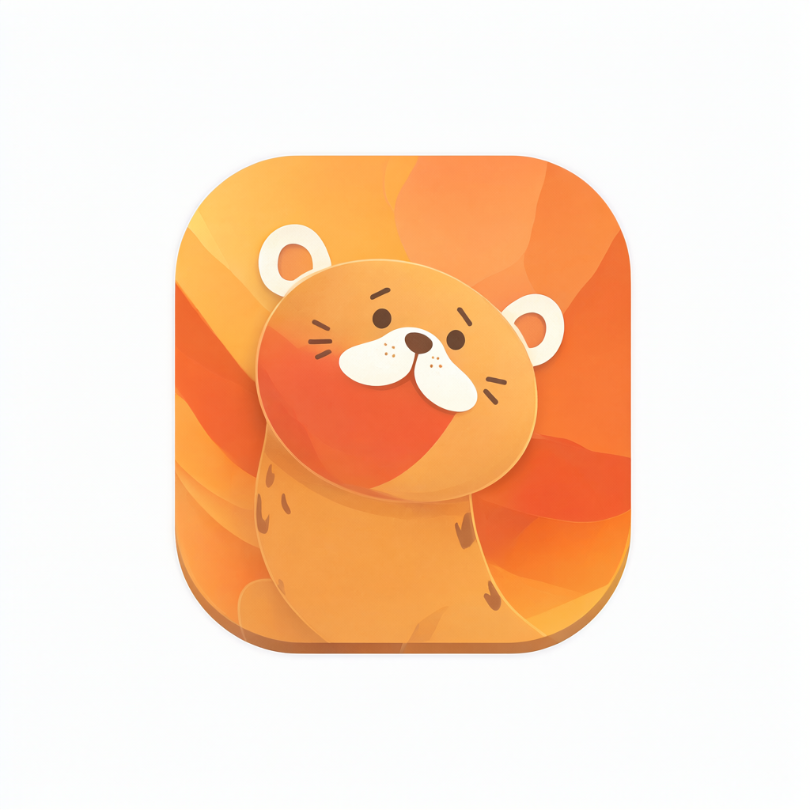</a><br><sub>1024×1024 · <a href="gallery/qwen/case-510.run.json">运行记录</a></sub></td>
</tr></table>

<sub>两侧画布同为方形。提示词**逐字节一致**。[提示词](cases/case-510/prompt.txt) · [案例页](https://aiwork4me.github.io/open-image-showdown/#/case/case-510)</sub>

---

## 其余 9 组对比

与上方完全相同的排版 —— **左：社区参考图（模型未验证），右：真实 Qwen 运行**，逐案一块。

### #1 · 城市生命系统图谱 —— 12 组中英双语面板

<table><tr>
<th width="50%">🟡 社区参考图<br><sub>模型未验证 · 已获作者授权镜像</sub></th>
<th width="50%">🟣 Qwen-Image 2.1 · 本机 ROCm 运行</th>
</tr><tr>
<td align="center"><a href="https://github.com/freestylefly/awesome-gpt-image-2/blob/63e6176fa01be51c000108dacd72716d3e46784b/docs/gallery-part-1.md#case-1">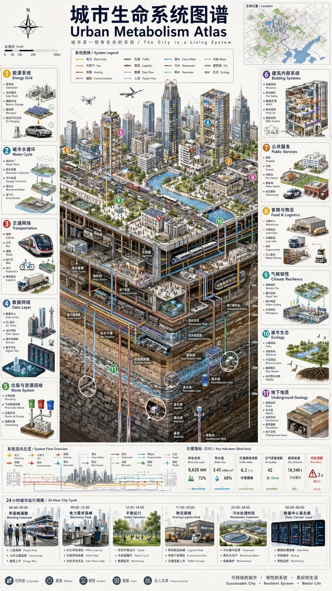</a><br><sub>941×1672 · © 小红书 insight_express · <a href="https://github.com/freestylefly/awesome-gpt-image-2/blob/63e6176fa01be51c000108dacd72716d3e46784b/docs/gallery-part-1.md#case-1">案例库 ↗</a></sub></td>
<td align="center"><a href="https://aiwork4me.github.io/open-image-showdown/#/case/case-1">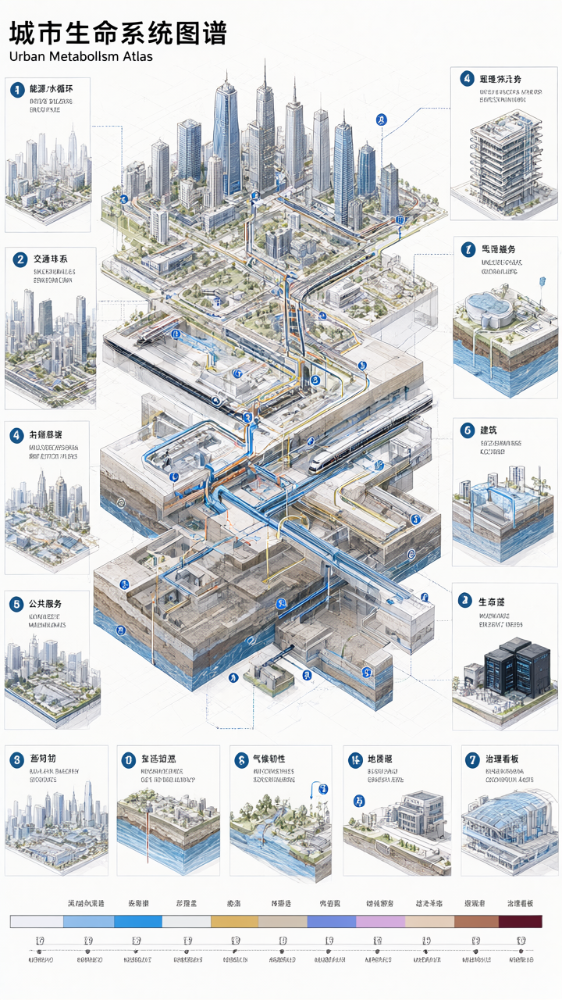</a><br><sub>720×1280 · <a href="gallery/qwen/case-1.run.json">运行记录</a></sub></td>
</tr></table>

<sub>提示词与上游**逐字节一致**。[提示词](cases/case-1/prompt.txt) · [案例页](https://aiwork4me.github.io/open-image-showdown/#/case/case-1)</sub>

---

### #13 · 数学试卷实拍 —— 照相写实 + 中文密排

<table><tr>
<th width="50%">🟡 社区参考图<br><sub>模型未验证 · 已获作者授权镜像</sub></th>
<th width="50%">🟣 Qwen-Image 2.1 · 本机 ROCm 运行</th>
</tr><tr>
<td align="center"><a href="https://github.com/freestylefly/awesome-gpt-image-2/blob/63e6176fa01be51c000108dacd72716d3e46784b/docs/gallery-part-1.md#case-13">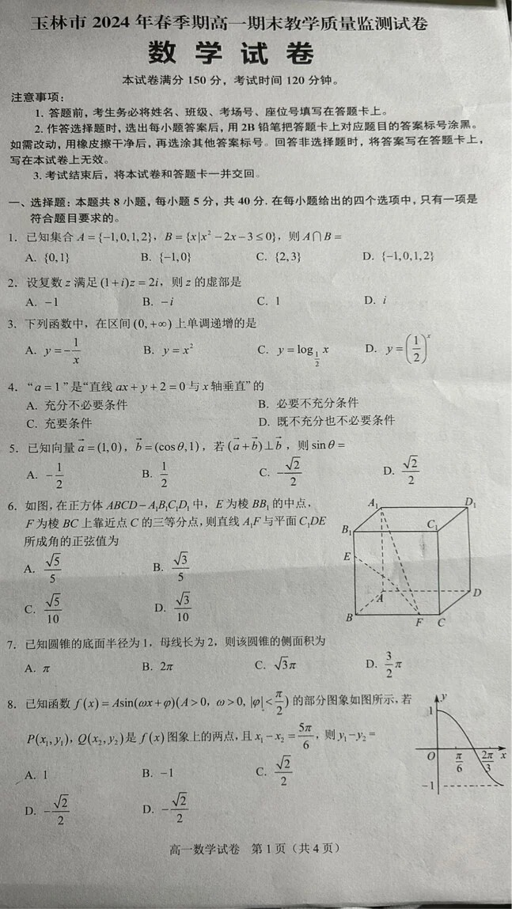</a><br><sub>647×1149 · © 小红书 94156710894 · <a href="https://github.com/freestylefly/awesome-gpt-image-2/blob/63e6176fa01be51c000108dacd72716d3e46784b/docs/gallery-part-1.md#case-13">案例库 ↗</a></sub></td>
<td align="center"><a href="https://aiwork4me.github.io/open-image-showdown/#/case/case-13">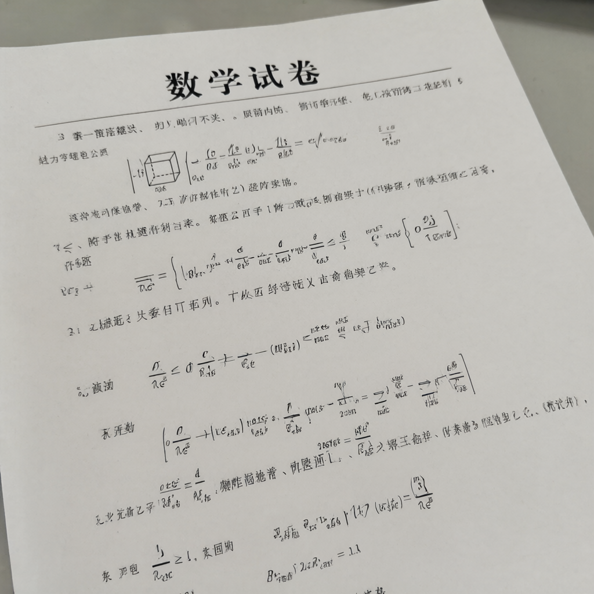</a><br><sub>1024×1024 · <a href="gallery/qwen/case-13.run.json">运行记录</a></sub></td>
</tr></table>

<sub>画布不同（参考图竖版，Qwen 方形）——各自完整展示，绝不裁切。提示词**逐字节一致**。[提示词](cases/case-13/prompt.txt) · [案例页](https://aiwork4me.github.io/open-image-showdown/#/case/case-13)</sub>

---

### #14 · 番茄炒蛋食谱信息图 —— 中文书法 + 版式

<table><tr>
<th width="50%">🟡 社区参考图<br><sub>模型未验证 · 已获作者授权镜像</sub></th>
<th width="50%">🟣 Qwen-Image 2.1 · 本机 ROCm 运行</th>
</tr><tr>
<td align="center"><a href="https://github.com/freestylefly/awesome-gpt-image-2/blob/63e6176fa01be51c000108dacd72716d3e46784b/docs/gallery-part-1.md#case-14">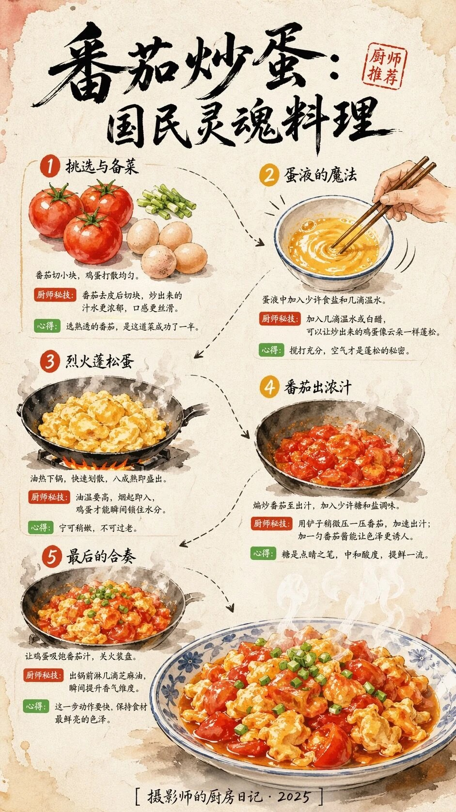</a><br><sub>941×1672 · © 小红书 Roy_Jay · <a href="https://github.com/freestylefly/awesome-gpt-image-2/blob/63e6176fa01be51c000108dacd72716d3e46784b/docs/gallery-part-1.md#case-14">案例库 ↗</a></sub></td>
<td align="center"><a href="https://aiwork4me.github.io/open-image-showdown/#/case/case-14">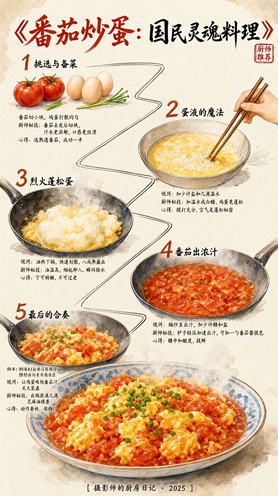</a><br><sub>720×1280 · <a href="gallery/qwen/case-14.run.json">运行记录</a></sub></td>
</tr></table>

<sub>提示词与上游**逐字节一致**。[提示词](cases/case-14/prompt.txt) · [案例页](https://aiwork4me.github.io/open-image-showdown/#/case/case-14)</sub>

---

### #344 · NOIR 街头服饰海报 —— 品牌质感

<table><tr>
<th width="50%">🟡 社区参考图<br><sub>模型未验证 · 已获作者授权镜像</sub></th>
<th width="50%">🟣 Qwen-Image 2.1 · 本机 ROCm 运行</th>
</tr><tr>
<td align="center"><a href="https://x.com/Daniel_adsss/status/2048542581638701446">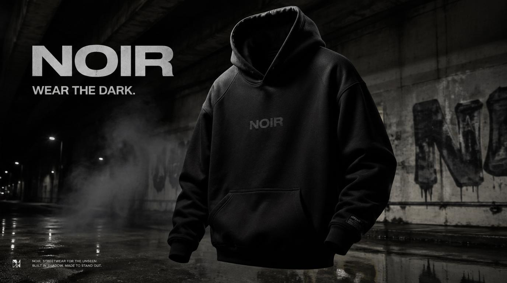</a><br><sub>1376×768 · © @Daniel_adsss · <a href="https://github.com/freestylefly/awesome-gpt-image-2/blob/63e6176fa01be51c000108dacd72716d3e46784b/docs/gallery-part-2.md#case-344">案例库 ↗</a></sub></td>
<td align="center"><a href="https://aiwork4me.github.io/open-image-showdown/#/case/case-344">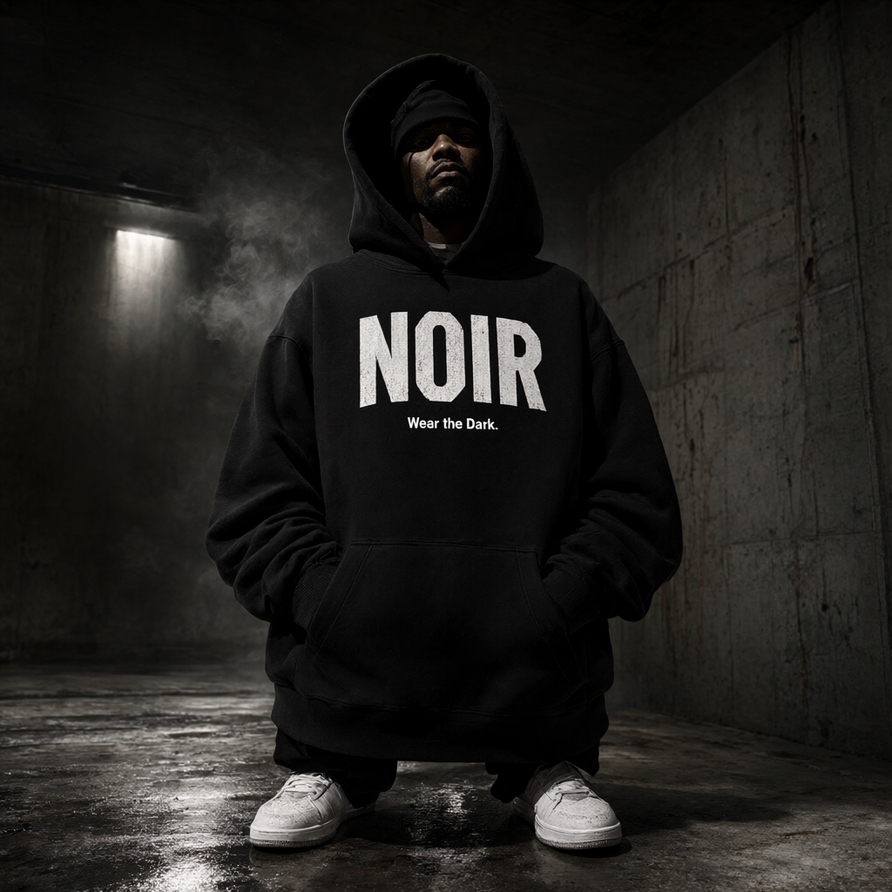</a><br><sub>1024×1024 · <a href="gallery/qwen/case-344.run.json">运行记录</a></sub></td>
</tr></table>

<sub>画布不同（参考图横版，Qwen 方形）——各自完整展示，绝不裁切。提示词**逐字节一致**。[提示词](cases/case-344/prompt.txt) · [案例页](https://aiwork4me.github.io/open-image-showdown/#/case/case-344)</sub>

---

### #414 · 室内晨间写实摄影 —— 自然光写实

<table><tr>
<th width="50%">🟡 社区参考图<br><sub>模型未验证 · 已获作者授权镜像</sub></th>
<th width="50%">🟣 Qwen-Image 2.1 · 本机 ROCm 运行</th>
</tr><tr>
<td align="center"><a href="https://x.com/ToroJushiAi/status/2053078195482632421">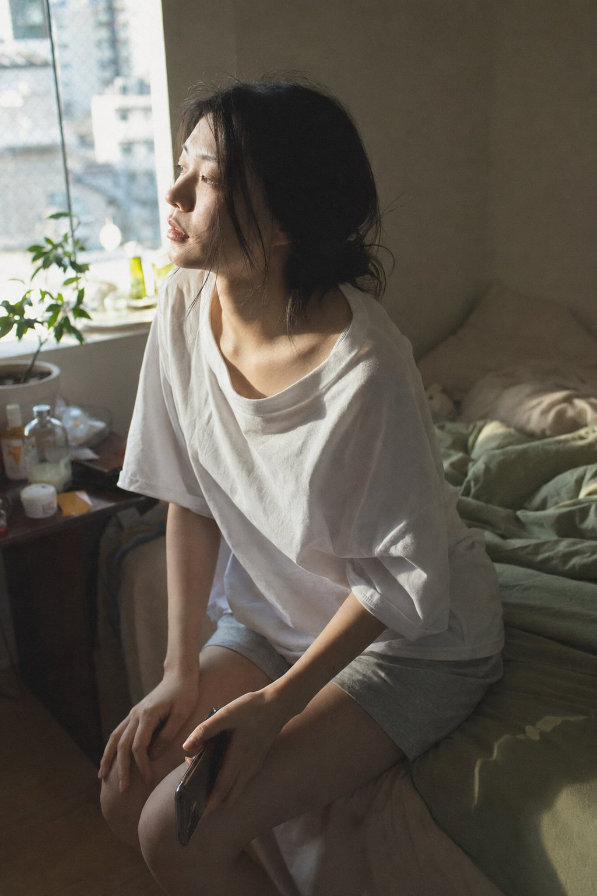</a><br><sub>1024×1536 · © @ToroJushiAi · <a href="https://github.com/freestylefly/awesome-gpt-image-2/blob/63e6176fa01be51c000108dacd72716d3e46784b/docs/gallery-part-2.md#case-414">案例库 ↗</a></sub></td>
<td align="center"><a href="https://aiwork4me.github.io/open-image-showdown/#/case/case-414"></a><br><sub>832×1248 · <a href="gallery/qwen/case-414.run.json">运行记录</a></sub></td>
</tr></table>

<sub>提示词与上游**逐字节一致**。[提示词](cases/case-414/prompt.txt) · [案例页](https://aiwork4me.github.io/open-image-showdown/#/case/case-414)</sub>

---

### #434 · 东京街头胶片人像 —— 胶片颗粒 + 签名

<table><tr>
<th width="50%">🟡 社区参考图<br><sub>模型未验证 · 已获作者授权镜像</sub></th>
<th width="50%">🟣 Qwen-Image 2.1 · 本机 ROCm 运行</th>
</tr><tr>
<td align="center"><a href="https://x.com/BubbleBrain/status/2055491616392052887">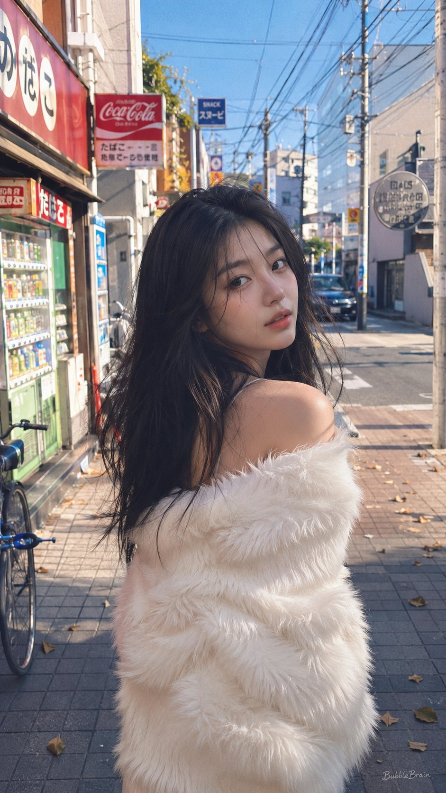</a><br><sub>941×1672 · © @BubbleBrain · <a href="https://github.com/freestylefly/awesome-gpt-image-2/blob/63e6176fa01be51c000108dacd72716d3e46784b/docs/gallery-part-2.md#case-434">案例库 ↗</a></sub></td>
<td align="center"><a href="https://aiwork4me.github.io/open-image-showdown/#/case/case-434">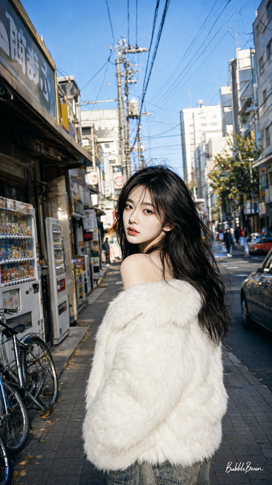</a><br><sub>720×1280 · <a href="gallery/qwen/case-434.run.json">运行记录</a></sub></td>
</tr></table>

<sub>提示词与上游**逐字节一致**。[提示词](cases/case-434/prompt.txt) · [案例页](https://aiwork4me.github.io/open-image-showdown/#/case/case-434)</sub>

---

### #390 · 羊毛毡微缩世界 —— 手工材质小世界

<table><tr>
<th width="50%">🟡 社区参考图<br><sub>模型未验证 · 已获作者授权镜像</sub></th>
<th width="50%">🟣 Qwen-Image 2.1 · 本机 ROCm 运行</th>
</tr><tr>
<td align="center"><a href="https://x.com/volkan_iras/status/2051403524966141980"></a><br><sub>1024×1536 · © @volkan_iras · <a href="https://github.com/freestylefly/awesome-gpt-image-2/blob/63e6176fa01be51c000108dacd72716d3e46784b/docs/gallery-part-2.md#case-390">案例库 ↗</a></sub></td>
<td align="center">
<a href="https://aiwork4me.github.io/open-image-showdown/#/case/case-390"></a> <a href="https://aiwork4me.github.io/open-image-showdown/#/case/case-390t"></a><br>
<sub>日本 · 冻结提示词（<a href="gallery/qwen/case-390.run.json">运行</a>）—— 土耳其 · 精确配对变体（<a href="gallery/qwen/case-390t.run.json">运行</a>）</sub>
</td>
</tr></table>

<sub>参考图描绘的是**伊斯坦布尔**；冻结提示词把上游模板 `[INSERT COUNTRY NAME]` 填成了日本，因此该配对为*派生* —— **土耳其变体才是精确提示词配对**（国家参数由参考图内容推断，非作者确认）。[提示词](cases/case-390/prompt.txt) · [变体提示词](cases/case-390t/prompt.txt) · [案例页](https://aiwork4me.github.io/open-image-showdown/#/case/case-390)</sub>

---

### #396 · 龙类复古百科海报 —— 复古信息密度

<table><tr>
<th width="50%">🟡 社区参考图<br><sub>模型未验证 · 已获作者授权镜像</sub></th>
<th width="50%">🟣 Qwen-Image 2.1 · 本机 ROCm 运行</th>
</tr><tr>
<td align="center"><a href="https://x.com/sha_zdiii/status/2052237839119835280">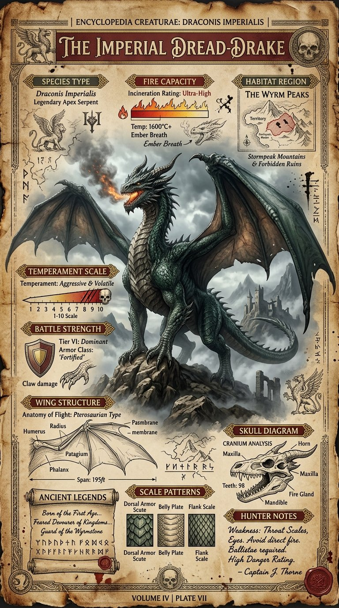</a><br><sub>768×1376 · © @sha_zdiii · <a href="https://github.com/freestylefly/awesome-gpt-image-2/blob/63e6176fa01be51c000108dacd72716d3e46784b/docs/gallery-part-2.md#case-396">案例库 ↗</a></sub></td>
<td align="center"><a href="https://aiwork4me.github.io/open-image-showdown/#/case/case-396">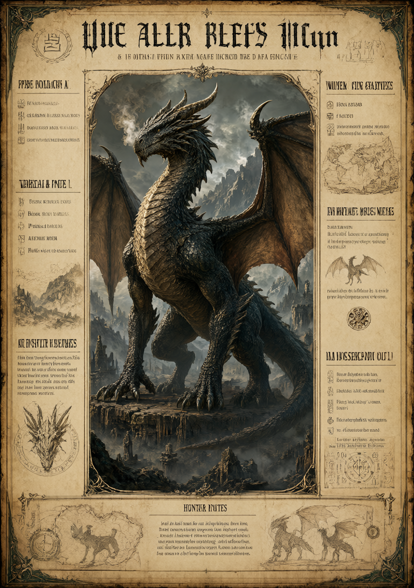</a><br><sub>768×1088 · <a href="gallery/qwen/case-396.run.json">运行记录</a></sub></td>
</tr></table>

<sub>画布不同（参考图 9:16，Qwen 近 A4）——各自完整展示，绝不裁切。提示词**逐字节一致**。[提示词](cases/case-396/prompt.txt) · [案例页](https://aiwork4me.github.io/open-image-showdown/#/case/case-396)</sub>

---

### #474 · 四城极简旅行海报 —— 扁平设计 + 城名排版

<table><tr>
<th width="50%">🟡 社区参考图<br><sub>模型未验证 · 已获作者授权镜像</sub></th>
<th width="50%">🟣 Qwen-Image 2.1 · 本机 ROCm 运行</th>
</tr><tr>
<td align="center"><a href="https://x.com/Taaruk_/status/2059188921096085888"></a><br><sub>1080×608 · © @Taaruk_ · <a href="https://github.com/freestylefly/awesome-gpt-image-2/blob/63e6176fa01be51c000108dacd72716d3e46784b/docs/gallery-part-2.md#case-474">案例库 ↗</a></sub></td>
<td align="center"><a href="https://aiwork4me.github.io/open-image-showdown/#/case/case-474"></a><br><sub>1280×720 · <a href="gallery/qwen/case-474.run.json">运行记录</a></sub></td>
</tr></table>

<sub>提示词与上游**逐字节一致**。[提示词](cases/case-474/prompt.txt) · [案例页](https://aiwork4me.github.io/open-image-showdown/#/case/case-474)</sub>

---

每张 Qwen 图都是真实、未修图的运行结果：bf16 权重、40 步、seed 42，完整运行记录见
[gallery/qwen](gallery/qwen) · 结果文档：[docs/QWEN_12_CASE_RESULTS.md](docs/QWEN_12_CASE_RESULTS.md)。
每张参考图均在记录在案的原作者授权下、从固定的案例库 commit `63e6176f` 镜像并经 sha256 核验：
[权利台账](gallery/reference/index.json) · [逐案审计](docs/REFERENCE_IMAGE_AUDIT.md)。

---

## 如何阅读这个画廊

- **左侧 —— 社区参考图。** 提示词的来源图片（MIT 协议案例库，逐案署名，经授权镜像）。
  其*生成模型身份未经验证* —— 没有任何证据能证明它出自哪个模型，所以永远不称它为「已验证的 GPT Image 2」。
- **右侧 —— Qwen-Image 2.1，永远真实。** 在 AMD RX 7900 XTX（ROCm、原生 Windows）上本机生成，
  12/12 主提示词 + 1 个精确配对变体，seed/权重/commit 全部记录在案。
- **第三个位置 —— 刻意留空。** 真正的*已验证 GPT Image 2* 图片，只有在贡献者带着运行证据投稿并通过审核后
  才会出现（[方法论](docs/METHODOLOGY.md)）。**不伪造配对、不编造排名、不做无法验证的宣称。**

[](https://github.com/AIwork4me/open-image-showdown/actions)
[](docs/QWEN_12_CASE_RESULTS.md)
[](docs/REFERENCE_IMAGE_AUDIT.md)
[](#自带-key投稿-gpt-结果)

## 自带 Key，投稿 GPT 结果

```bash
# 1) 你的 Key 只放在环境变量里 —— 绝不写进文件、Issue 或 PR
$env:OPENAI_API_KEY = "sk-..."

# 2) 选一个案例 —— 先显示模型/尺寸/画质/费用预估，输入 YES 才会发起付费请求
uv run --no-project python -I tools/generate_gpt.py --case case-443

# 3) 把生成的 image.png + run.json + SUBMISSION.md 附到 Issue：
#    https://github.com/AIwork4me/open-image-showdown/issues/new?template=gpt_submission.md
```

CLI 固定使用 `gpt-image-2-2026-04-21` 快照，默认只生成一张，尺寸与 Qwen 画布逐像素一致
（gpt-image-2 支持自定义 16 像素倍数尺寸 —— 两个模型面对同一画布），重试上限 2 次，并且
**在写盘前对每个产物做密钥自扫描**。见 [docs/SECURITY.md](docs/SECURITY.md)。

在别处生成的图（ChatGPT 等客户端）？欢迎手动投稿 —— 按证据等级标注，绝不自动转正。
详见 [CONTRIBUTING.md](CONTRIBUTING.md)。

## 复现 Qwen 侧

需要 AMD gfx1100 显卡（RX 7900 XTX）、[qwen-image-rocm](https://github.com/AIwork4me/qwen-image-rocm)
引擎（权重与 ComfyUI 均按 commit 固定）、Windows + ROCm：

```powershell
# 启动 Quality 服务器（bf16、--disable-smart-memory、SDPA math）
powershell -File <qwen-image-rocm>\phase2-comfyui\launch_comfyui.ps1 -Port 8188 `
  -SdpMode math -ComfyArgs "--disable-smart-memory"
```

```bash
uv run --python 3.12 --with requests --with websocket-client --with jsonschema \
  python -I tools/generate_qwen.py --base-url http://127.0.0.1:8188
```

相同的固定权重（`Comfy-Org/Qwen-Image-2.1@aacf31a6`）+ ComfyUI commit + seed 42
可确定性地复现每一张图。12/12 主案例 + 1 变体全部干净跑完（约 1 MP，46–60 秒/张、14–16 GB 显存）——
包括这套 GPU 栈有记录以来的首批非方形画布。[完整运行记录 →](docs/QWEN_12_CASE_RESULTS.md)

## 仓库结构

```
cases/            12 个冻结案例（manifest + prompt.txt，sha256 锁定）
                  + case-390t（精确配对变体：土耳其主题）
gallery/qwen/     真实 Qwen 产物 + 每次运行的完整溯源记录
gallery/reference/  权利台账（index.json）+ 经授权镜像的参考图
submissions/      社区 GPT 投稿（审核制）
tools/
  generate_gpt.py       BYOK GPT CLI（费用门禁、密钥自扫描）
  generate_qwen.py      Qwen 批量驱动（复用引擎仓库客户端）
  validate_gallery.py   完整性门禁（schema、sha256、尺寸、密钥扫描、
                        权利台账、镜像门禁、禁热链、数量一致性）
  mirror_reference.py   权利门禁式参考图镜像（非 APPROVED 直接拒绝）
  make_social_cards.py  1200×630 双栏分享卡（全部来自真实图片）
web/              Vite + React + TS 站点（纯静态、天生无 Key）
tests/            契约测试（BYOK API 契约、安全不变量、画廊、参考图权利）
docs/             审计、运行结果、方法论、安全、许可
```

## 信任与验证

- **状态由 schema 强制**：`OPEN_CHALLENGE` → `COMMUNITY_SUBMITTED` → `REVIEWED_COMPARISON`（或 `BLOCKED`）。参考图永远不能让案例升级。[方法论 →](docs/METHODOLOGY.md)
- **参考图受权利门禁**：仅在作者授权（台账 APPROVED）后镜像，sha256 对账审计指纹，绝不热链、绝不冒充已验证 GPT。README/网站的展示数量由台账派生 —— [权利审计 →](docs/REFERENCE_IMAGE_AUDIT.md)
- **自动化门禁**（每个 PR）：提示词/图片 sha256 复算、尺寸校验、溯源完整性、重复检测、密钥扫描、站点数据一致性、参考图权利/镜像/数量门禁、静态构建。[CI →](.github/workflows/ci.yml)
- **独立性**：*独立社区研究项目。与 OpenAI、阿里/Qwen、AMD 均无关联，也未获其认可。*
- **三层许可分列**：代码 MIT · 案例提示词经 MIT 案例库转载（保留署名）· Qwen 图片 CC BY-NC 4.0（权重受 Qwen Research License 约束）。参考图版权归原作者。[许可与来源 →](LICENSES_AND_SOURCES.md)

## 致谢

- [freestylefly/awesome-gpt-image-2](https://github.com/freestylefly/awesome-gpt-image-2) 及逐案署名、并已授权展示参考图的各位原作者
- [AIwork4me/qwen-image-rocm](https://github.com/AIwork4me/qwen-image-rocm)（引擎）、[ComfyUI](https://github.com/comfyanonymous/ComfyUI)、Qwen-Image-2.1、GPT Image 2

---

<div align="center"><b>同一提示词，两个模型，你来评判。</b><br/><sub>Same Prompt. Two Models. You Decide.</sub></div>
